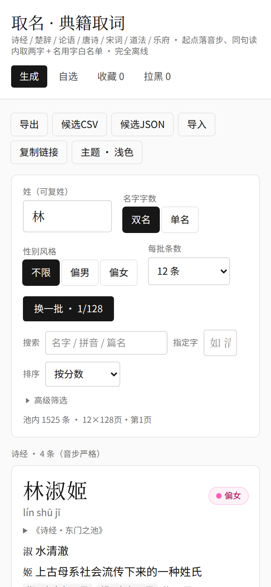

# 取名 · 典籍取词

从七本中文典籍（诗经 / 楚辞 / 论语 / 水墨唐诗 / 宋词三百首 / 道法 / 乐府诗集）里，按「起点落音步、同句读内取两字、且两字都在名用字白名单内」的口径，生成有出处的双字名与单字名。

**完全离线**：一个静态站点，运行时零网络请求；数据全部随包发布。所有筛选与打分都在浏览器里跑。

## 定位：这是取名的**素材工具**，不是命理工具

本应用刻意**不做**五行筛选、八字五格、生肖宜忌、"补缺"建议、吉凶判定。它给的是**可核对的事实**：

- 名字出自哪句、哪个字、第几字；
- 字的本义（来自开放词典）；
- 笔画、结构（独体/上下/左右…）；
- 声调、谐音、是否多音字；
- 名用字的真实使用频次（分档：很常见 / 常见 / 一般 / 少见 / 冷僻）。

卡片上标的「部首」只取康熙字典**木火水金土**五部这一可核对的事实，且只覆盖白名单里查得到的那部分字。**未标不代表该字无五行**——留白是留白，不是结论。要不要参考五行，交给你和你的依据。

## 快速开始

```bash
npm install
npm run dev        # 构建数据 + 起开发服务器
npm run build      # 构建数据 → 门禁 → 类型检查 → lint → 测试 → vite build → 体积门禁
npm run build:single   # 同上，但打成单个 HTML 文件（SINGLE=1）
npm run serve      # 用 python3 静态伺服 dist（端口 5178）
npm run lint       # ESLint（flat config）
npm run format     # Prettier 写回
npm run test:e2e   # Playwright + axe（需先 npm run build；首次 npx playwright install chromium）
```

Node 需要 **22.19+**（vitest 4 的 fetch 依赖 undici 8，要求 ≥22.19；Node 20 已 EOL。见 `.nvmrc` / `package.json` 的 `engines`，CI 跑 22 与 24）。

## 部署（GitHub Pages）

推送到 `main` 分支即自动构建并发布到 GitHub Pages（见 `.github/workflows/deploy-pages.yml`）。

**首次配置**：
1. 在 GitHub 建一个公开仓库（如 `naming-app`），把代码推上去。
2. 仓库 Settings → Pages → Build and deployment → Source 选 **GitHub Actions**。
3. 推送后 Actions 自动跑 `npm run build` 并发布，几分钟后访问 `https://<用户名>.github.io/naming-app/`。

> 免费账户只能从公开仓库发布 Pages。本项目无密钥无隐私数据，公开没问题。

## 功能

- **生成**：按姓氏（含复姓、多音姓读音选择）过滤出一页候选，出处可核对；每张卡片给出**出处今译**（本项目自撰，只解释句意）；换一批分页不重不漏。
- **自选**：自己选姓与第 1、2 个字（支持任意汉字，非名用字会标注），实时核对读音/谐音/字义/字形；**有典籍出处就显示原句与今译，没有就明说没有**，不拿别的句子凑。另有「换一批随机」（默认只随机有出处的）、「同句读搭配字」顺藤摸瓜；无出处的组合不进收藏。
- **筛选**：性别风格、字数（单/双）、典籍开关、只看叠字、搜索、排序；**指定用字**（限首字/末字，从有出处的搭配里挑定字）；以及可核对事实类筛选——**整名笔画上限**、**避开两字同结构**、**逐字用字常见度下限**。
- **收藏**：备注 / 分组 / 搜索 / 排序（最近·分数·笔画·常见度）/ 按分组过滤；勾选 2–3 个进入**对比表**。
- **导出/导入**：JSON 备份（导入时可选**合并**或**覆盖**）；当前筛选下的**候选全量导出**（JSON / CSV，含出处原句与今译）；**复制链接**只带轻量筛选，收藏与拉黑留在本机。
- **分享**：单名羊皮纸卡片（含原句与今译，附离线生成的**二维码**）、收藏页**导出名单长图**、**打印名单**（打印样式只保留卡片正文）；「复制信息」同样带今译；自选组合若无出处，卡片与摘要会明确写「未见此搭配」。
- **主题**：浅色 / 深色 / **跟随系统**三态，随系统偏好实时切换。
- **PWA**：可安装，离线可用；有新版本或离线时顶部给出提示。

## 截图

对构建产物实拍（`scripts/screenshots.mjs`，Chromium 2x 渲染）：

| 生成页（浅色） | 生成页（深色） |
|---|---|
|  |  |

| 自选页（苏子归，楚辞·江有汜） | 生成页（手机 390px） |
|---|---|
|  |  |

## 目录

```
data/raw/         上游原始数据 + 许可全文（licenses/）+ SHA256SUMS
scripts/          构建管线与设计期诊断
  build-data.mjs    把 raw 固化成 src/data/*.json（唯一的正式数据来源）
  verify.mjs        P0 门禁：指纹、账目、出处、结构…
  size-check.mjs    体积门禁（gzip 预算 400 KB）
  derive-dict.mjs   一次性派生：从上游词典/语料裁出 dict_shape / dict_gloss / name_given_freq
  l0-keep.mjs       诊断脚本读取 l0-verdicts.txt「保留」字的共享工具
  l0-unlock.mjs     候选字边际增量排行 + 人工过字待审表
  measure-*.mjs     设计期实测（漏斗 / L0 曲线 / 取词阶梯 / 道法产率）
src/
  engine/           纯函数引擎：数据装配（含运行时 schema 自检）、取词、打分、音韵、字形、常见度
  store/            localStorage 持久化 + 导入导出 + URL 状态编解码
  ui/               Controls / NameCard / ErrorBoundary
  lib/share.ts      分享卡片 / 名单长图（Canvas，二维码用 uqr 本地生成）+ 下载/复制
  lib/pwa.ts        Service Worker 注册、离线与「有新版本」状态
  data/             构建产物（勿手改）
  test-setup.ts     单测公共初始化（jest-dom 断言 + cleanup）
public/             PWA：manifest / icon.svg + icon-192/512.png / service worker
tests/e2e/          Playwright 端到端 + axe 可访问性扫描
```

## 常见问答

- **为什么不做五行 / 八字 / 五格 / 吉凶？** 这些规则没有可核对的共识口径，做出来的是「看起来有依据」而非依据。本应用只给能逐条核对的事实（出处、字义、笔画、结构、读音、真实用名频次），判断权留给你。
- **语料是哪七本、为什么没有我想读的书？** 诗经 305 首 / 楚辞 65 篇 / 论语 20 篇 / 水墨唐诗 176 首 / 宋词三百首 / 道法 22 行（手工录入并逐行核对归属）/ 乐府诗集 20 篇（维基文库整理本抄录、四库本交叉校）。每本的规模与许可在 `data/raw/LICENSES.md`，加书有门禁纪律（只许新增、出处改判必须间隔变小且逐条断言）。
- **为什么名用字只有 293 个？** 这是「真有人在名字里用」的种子字表 ∩ 通用规范汉字表，外加人工过字的保留判定；想扩表跑 `scripts/l0-unlock.mjs` 出待审表，判定文本有指纹，扩表后全部门禁换下界模式、老名字一条不许丢。
- **出处今译是谁写的？** 本项目自撰（1,140 行，逐句对应），只解释句意，不引用任何现代整理本的注释与译文。

## 数据来源与许可

原始数据放在 `data/raw/`，每份的上游、许可、说明见 [`data/raw/LICENSES.md`](data/raw/LICENSES.md)，许可全文在 `data/raw/licenses/`。`verify.mjs` 会核对 `data/raw/SHA256SUMS`，改动原始数据必须同步更新指纹。

## 测试

```bash
npm run typecheck   # tsc --noEmit
npm run lint        # ESLint
npm test            # Vitest（9 个文件，148 用例）
npm run test:e2e    # Playwright + axe（先 npm run build）
```

单测覆盖引擎（取词口径、打分、音韵、字形、常见度、检索排序、**笔画/结构/常见度筛选**）、store（持久化、导入导出往返、URL 编解码、导入写回）、分享（卡片/二维码/名单图）、以及 Controls / NameCard / App 的组件与集成渲染。端到端在真实 Chromium 上跑关键路径，并做 axe（WCAG 2 A/AA）扫描。
